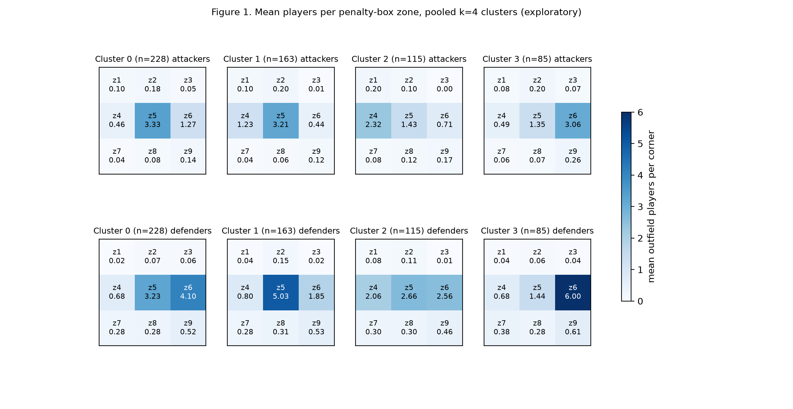
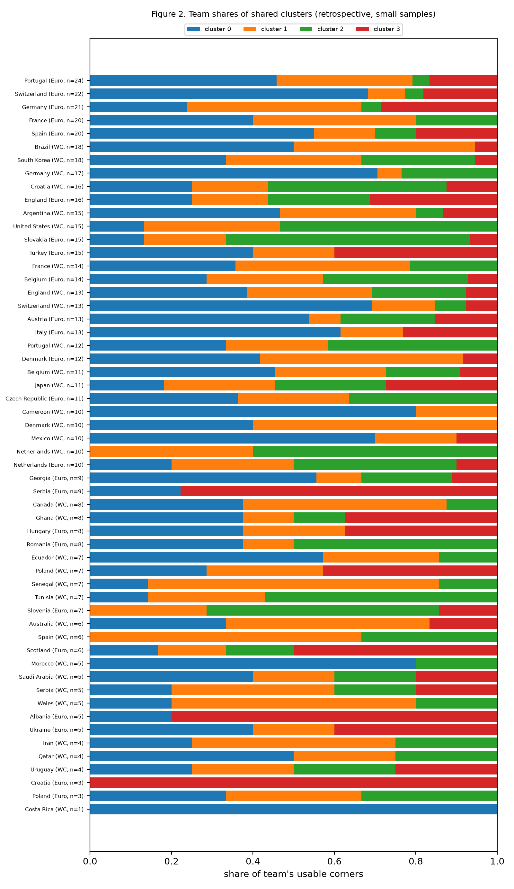

# Spatial Results: 360 Static Setup Analysis

Exploratory, retrospective results. All numbers below were produced by the commands in the
last section and can be checked against `docs/spatial-results/`.

## Methods
Corner events were joined to StatsBomb 360 freeze frames on `(match_id, corner_event_id)`.
Bottom-side corners were mirrored so all corners face the same way. A corner is usable if it
has a matching frame, its location is within 3 yards of a corner flag, at least 5 players
are visible, and at least 50% of the penalty box lies inside the visible-area polygon.
Each usable corner becomes an 18-number vector: counts of attacking and defending outfield
players in the nine zones (z1 to z9) of the penalty box (the corner taker and keepers are
excluded). Deterministic k-means (k=4 primary) was fitted once on all usable corners from
both tournaments. Stability is the mean adjusted Rand index (ARI) over ten 80% subsamples.
ARI measures whether resampling reproduces the same grouping; it does not show that the
groups are meaningful tactical setups.

## Results
Of 1,083 corners (World Cup 2022 and Euro 2024), 592 (54.7%) had a matching 360 frame and 591
were usable; one matched frame was excluded for low visibility (box coverage 0.265).
The pooled fit gave four clusters of 228, 163, 115 and 85 corners, with stability ARI = 0.864.
The 591 usable corners were split into 56 team profiles (32 World Cup, 24 Euro). No team has
more than 24 usable corners, so every team profile is a small sample.
Per `docs/tournament-360-delivery-coverage.md`, short corners are matched far less often
(World Cup 29.2%, Euro 32.3%) than other deliveries (55.9% and 60.0%), so the clusters
under-represent short-corner setups. Whether frames are missing at random is unknown.



**Figure 1.** Mean number of players per penalty-box zone for each cluster (values from
`setup_report.json`). Attackers: cluster 0 has means of 3.33 in z5 and 1.27 in z6; cluster 1
3.21 in z5 and 1.23 in z4; cluster 2 2.32 in z4 and 1.43 in z5; cluster 3 3.06 in z6 and
1.35 in z5. Defenders: z6 means are 4.10, 1.85, 2.56 and 6.00 for clusters 0 to 3; cluster 1
has 5.03 in z5. Clusters are described by these numbers only; no tactical labels are assigned.



**Figure 2.** Each team's share of its usable corners in each shared cluster (n = usable
corners, between 1 and 24). Shares from teams with few corners are not interpretable; for
example a team with one usable corner shows 100% in one cluster. No intervals are computed.

## Sensitivity analysis
All rows use the same corner table; commands are listed below. Raw reports are in
`docs/spatial-results/reports/` and the table in `docs/spatial-results/sensitivity.csv`.

| Setting | Usable | Cluster sizes | ARI |
| --- | ---: | --- | ---: |
| k=4, box coverage 0.5 (primary) | 591 | 228/163/115/85 | 0.864 |
| k=4, box coverage 0.3 | 591 | 228/163/115/85 | 0.864 |
| k=4, box coverage 0.7 | 587 | 233/162/108/84 | 0.8589 |
| k=3, box coverage 0.5 | 591 | 246/201/144 | 0.841 |
| k=5, box coverage 0.5 | 591 | 184/156/105/98/48 | 0.7267 |
| k=6, box coverage 0.5 | 591 | 167/163/79/79/55/48 | 0.7074 |

Lowering the coverage threshold to 0.3 changes nothing, because the single excluded frame is
below 0.3. At 0.7, four more frames are excluded and cluster sizes shift slightly. Among
k = 3 to 6, k=4 has the highest stability; k=5 and k=6 are less stable and create a
48-corner cluster. All runs are above the implementation's 0.6 stability threshold, which is
a technical flag, not evidence that the clusters are real setups. k=4 was fixed in advance
and not tuned.

## Corner table comparison with the reference file
My `corner_summary.csv` (SHA-256 `9d6229d8...`) differs from the reference (`343938466196...`).
A full comparison of all 1,083 rows and 35 columns (37,905 cells,
`docs/spatial-results/hash-comparison.txt`) shows identical keys, row order, columns and values
except `short_limit`, which is written as `15.0` in my file and `15` in the reference file,
in every row. This accounts for the whole 2,166-byte size difference. Line endings are
identical (CRLF) in both. The cause of the formatting difference (code version) is not yet
established.

## Limitations
Clusters describe static snapshots at delivery, not player runs or marking. They were fitted
on the full tournaments, including later matches, so they are retrospective only; a prematch
dossier would need a separate fit using only earlier data. Only 54.7% of corners have frames,
short corners are under-covered, the visible area limits what is observed, and teams have
at most 24 usable corners.

## Reproduction
Python 3.13.0, repository commit f8b66b0616664a3c90b28d12197e95b7e2cba724, data revision
4b73468fc5b0f1950f9f66fada70ad3a4f9327cb.

```powershell
python -m src.data --config configs/data/wc2022-euro2024.json --parquet
python src/run_corner_batch.py --manifest data/ingested/wc2022-euro2024/batch_manifest.json --output outputs/utkarsh-corners --window 15 --short-limit 15 --parquet
python -m src.profile_tournament_360 --corners outputs/utkarsh-corners/corner_summary.csv --coverage-manifest data/ingested/wc2022-euro2024/coverage_manifest.json --frames-dir data/raw/4b73468fc5b0f1950f9f66fada70ad3a4f9327cb/data/three-sixty --output outputs/utkarsh-360-coverage
python -m src.profile_tournament_setups --corners outputs/utkarsh-corners/corner_summary.csv --coverage-manifest data/ingested/wc2022-euro2024/coverage_manifest.json --frames-dir data/raw/4b73468fc5b0f1950f9f66fada70ad3a4f9327cb/data/three-sixty --coverage-profile outputs/utkarsh-360-coverage/provenance.json --output outputs/utkarsh-shared-clusters

# Sensitivity (each with a new output folder)
python -m src.setups --corners outputs/utkarsh-corners/corner_summary.csv --three-sixty-dir data/raw/4b73468fc5b0f1950f9f66fada70ad3a4f9327cb/data/three-sixty --output outputs/utkarsh-setups-k4 --k 4
python -m src.setups --corners outputs/utkarsh-corners/corner_summary.csv --three-sixty-dir data/raw/4b73468fc5b0f1950f9f66fada70ad3a4f9327cb/data/three-sixty --output outputs/utkarsh-setups-k4-cov30 --k 4 --min-box-coverage 0.3
python -m src.setups --corners outputs/utkarsh-corners/corner_summary.csv --three-sixty-dir data/raw/4b73468fc5b0f1950f9f66fada70ad3a4f9327cb/data/three-sixty --output outputs/utkarsh-setups-k4-cov70 --k 4 --min-box-coverage 0.7
python -m src.setups --corners outputs/utkarsh-corners/corner_summary.csv --three-sixty-dir data/raw/4b73468fc5b0f1950f9f66fada70ad3a4f9327cb/data/three-sixty --output outputs/utkarsh-setups-k3 --k 3
python -m src.setups --corners outputs/utkarsh-corners/corner_summary.csv --three-sixty-dir data/raw/4b73468fc5b0f1950f9f66fada70ad3a4f9327cb/data/three-sixty --output outputs/utkarsh-setups-k5 --k 5
python -m src.setups --corners outputs/utkarsh-corners/corner_summary.csv --three-sixty-dir data/raw/4b73468fc5b0f1950f9f66fada70ad3a4f9327cb/data/three-sixty --output outputs/utkarsh-setups-k6 --k 6

# Table and figures
python spatial_artifacts.py --out docs/spatial-results --primary outputs/utkarsh-setups-k4 --teams outputs/utkarsh-shared-clusters --run "Primary_k4_cov0.5=outputs/utkarsh-setups-k4" --run "k4_cov0.3=outputs/utkarsh-setups-k4-cov30" --run "k4_cov0.7=outputs/utkarsh-setups-k4-cov70" --run "k3_cov0.5=outputs/utkarsh-setups-k3" --run "k5_cov0.5=outputs/utkarsh-setups-k5" --run "k6_cov0.5=outputs/utkarsh-setups-k6"